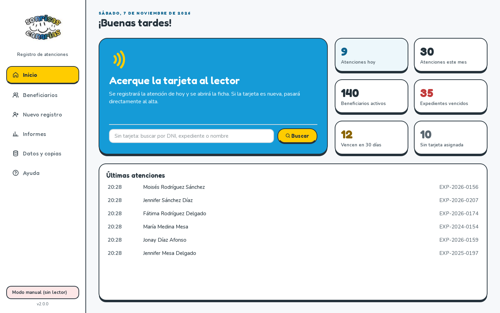
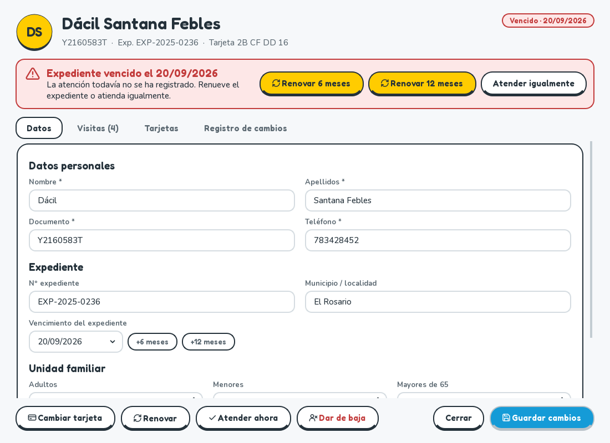
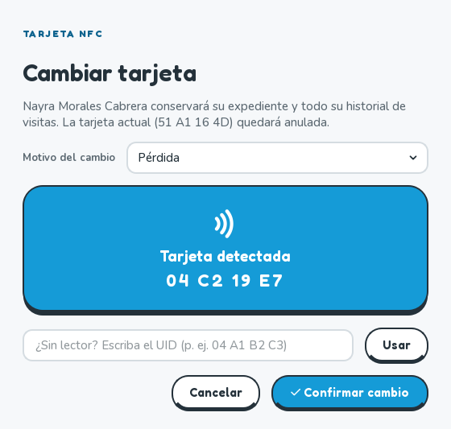
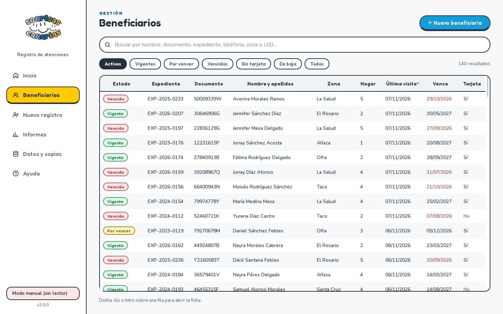
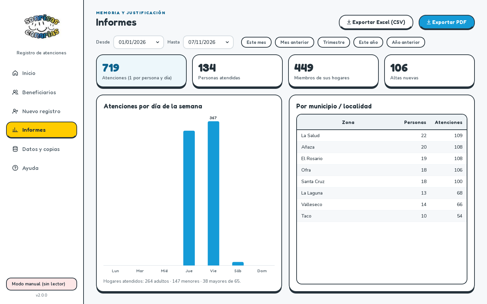

<p align="center">
  
</p>

<h1 align="center">Sonrisas NFC</h1>

<p align="center">
  Registro de beneficiarios y atenciones con tarjetas NFC para el banco de alimentos de
  <b>ONG Sonrisas Canarias</b>.<br>
  Aplicación de escritorio para Windows · Python 3.11+ · PySide6 (Qt 6) · SQLite · ACR122U
</p>

<p align="center">
  
</p>

---

## El problema

La ONG atiende a cientos de familias en su sede de Valleseco. Cada persona tiene un expediente
social con fecha de vencimiento y una tarjeta NFC. Al pasar la tarjeta por el lector hay que
identificar a la persona, comprobar que su expediente está en vigor y registrar la atención. Ese
registro alimenta los informes de justificación ante administraciones y patrocinadores.

La versión 1 llevaba en uso desde septiembre de 2025, con 487 beneficiarios y 2.447 visitas.
Esta versión 2 es una reescritura completa, a partir de una auditoría del código y de los datos reales.

## Qué aporta la versión 2

| | Versión 1 | Versión 2 |
|---|---|---|
| **Visitas duplicadas** | Con la tarjeta apoyada en el lector se registraba una visita nueva cada 1,5 s: el **27 %** de las visitas reales eran repeticiones | Se cuenta una atención por persona y día; el lector notifica solo cuando se **acerca** la tarjeta |
| **Tarjeta perdida** | No se podía cambiar sin perder el historial | **Cambio de tarjeta** con motivo (pérdida, robo, deterioro). La tarjeta antigua queda anulada y se detecta si reaparece |
| **Expedientes vencidos** | No había ningún aviso (279 vencidos) | Aviso en rojo al pasar la tarjeta; renovación a 6 o 12 meses con un clic |
| **Corregir un DNI** | No guardaba nada o sobrescribía la ficha de otra persona | Se puede corregir: la clave interna es un `id` |
| **Bajas** | Borraban el historial y alteraban informes pasados | Baja lógica: el historial se conserva y la ficha se puede reactivar |
| **DNI/NIE** | Expresión regular permisiva | Se valida la letra de control y se sugiere la correcta |
| **Lector** | Lectura en el hilo de la interfaz; desconectarlo obligaba a reiniciar | Hilo propio; detecta conexión y desconexión en caliente |
| **Datos** | Junto al `.exe`; el instalador podía sobrescribirlos | En `%LOCALAPPDATA%`, con copia automática diaria y registro de cambios |
| **Código** | Un archivo de 1.733 líneas con unas 650 duplicadas y sin tests | Capas separadas, 115 tests (incluidas pruebas de extremo a extremo de la interfaz) y lint limpio |

## Capturas

| Ficha tras pasar la tarjeta | Cambio de tarjeta perdida |
|---|---|
|  |  |

| Beneficiarios | Informes |
|---|---|
|  |  |

Los informes se exportan a PDF desde la pantalla *Informes*.
Todas las capturas usan **datos ficticios** generados por `sonrisas_nfc.demo`.

El diseño sigue la identidad visual de la ONG:
azul cielo y amarillo sol, contornos en tinta con sombras sólidas y las tipografías Fredoka y Nunito.

## Arquitectura

```
src/sonrisas_nfc/
├── domain/        Entidades y validaciones (sin dependencias)
│   ├── models.py        Beneficiario, Visita, Tarjeta, estados del expediente
│   └── validators.py    DNI/NIE con letra de control, teléfono, UID
├── db/database.py SQLite: transacciones y migraciones versionadas (PRAGMA user_version)
├── services/      Lógica de negocio, sin interfaz y probada con tests
│   ├── atencion.py      Qué pasa al leer una tarjeta (máquina de decisiones)
│   ├── beneficiarios.py Alta, edición, búsqueda, renovación y baja
│   ├── tarjetas.py      Asignación y reemplazo sin perder el historial
│   ├── visitas.py       Una atención por persona y día
│   ├── informes.py      Cifras del panel e informes por periodo
│   ├── importador.py    Migración desde la base de datos de la v1
│   └── copias.py        Copias de seguridad automáticas
├── nfc/lector.py  Lector PC/SC en un QThread (presencia y retirada de tarjeta)
└── ui/            PySide6: tema, componentes, páginas y diálogos
```

**Modelo de datos.** Las visitas cuelgan del *beneficiario*, no de la tarjeta. Así, cambiar de
tarjeta o corregir un documento nunca afecta al historial. Las tarjetas guardan su propio
historial (`asignada_en`, `baja_en`, `motivo_baja`). Un índice único parcial garantiza que cada
UID esté activo en una sola persona.

## Puesta en marcha (desarrollo)

```powershell
python -m venv .venv
.venv\Scripts\pip install -e ".[dev]"

.venv\Scripts\sonrisas-nfc --demo     # datos ficticios en una carpeta temporal
.venv\Scripts\pytest                  # tests
.venv\Scripts\ruff check src tests    # lint
```

Sin lector conectado, la aplicación funciona en modo manual: se busca por documento o nombre y
se pulsa *Atender ahora*.

Para comprobar una importación con datos reales sin mostrar ningún dato personal:

```powershell
.venv\Scripts\python scripts\verificar_datos.py RUTA\ong_usuarios.db
```

## Generar el ejecutable y el instalador

```powershell
powershell -ExecutionPolicy Bypass -File packaging\construir.ps1
```

El script ejecuta los tests y genera `dist\SonrisasNFC\SonrisasNFC.exe` con PyInstaller. Si
[Inno Setup 6](https://jrsoftware.org/isinfo.php) está instalado, crea también el instalador en
`packaging\Output\`.

## Migración desde la versión 1

Ver [`docs/MIGRACION.md`](docs/MIGRACION.md). En resumen: al primer arranque, la aplicación
detecta `ong_usuarios.db` y ofrece importarlo. El archivo original no se modifica. Se conservan
todas las visitas; las repetidas el mismo día quedan marcadas para que no cuenten en los informes.

## Protección de datos

Los datos son de personas en situación de vulnerabilidad. Por eso:

- Se guardan solo en el equipo de la sede, sin conexión a internet.
- El repositorio **ignora cualquier `.db`** (`.gitignore`). Las capturas y los tests usan datos inventados.
- Las bajas son lógicas, y el registro de cambios deja constancia de altas, ediciones y cambios de tarjeta.

## Licencia

© Todos los derechos reservados. Software desarrollado para ONG Sonrisas Canarias.
Su uso por otras entidades requiere autorización expresa del autor.
Las fuentes Fredoka y Nunito se distribuyen bajo SIL Open Font License (ver `assets/fonts`).
