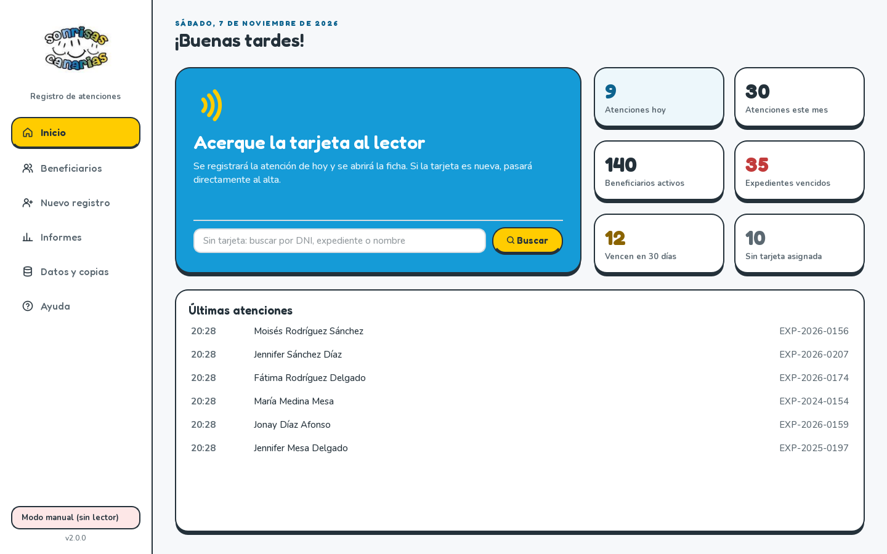
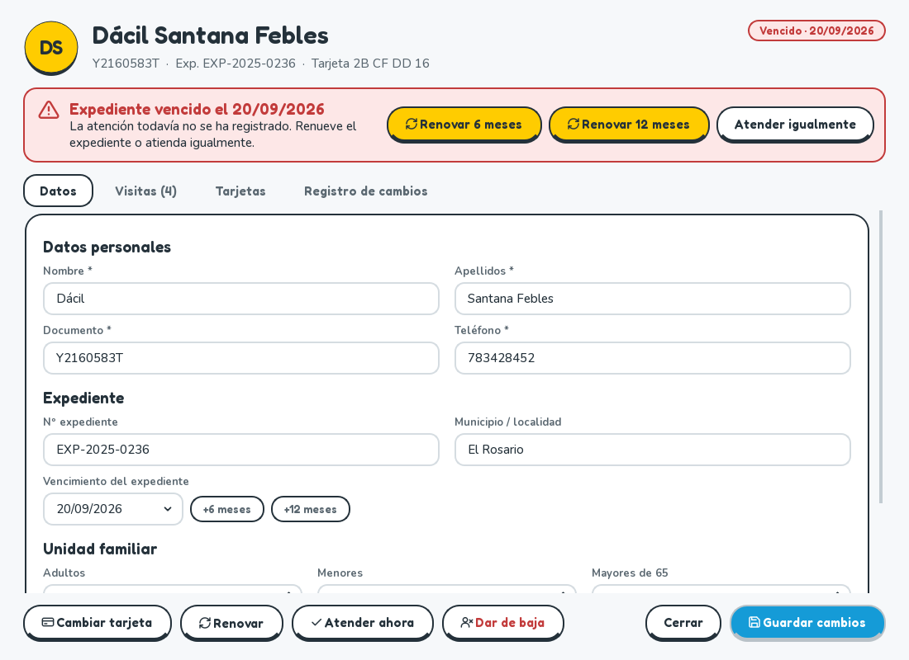
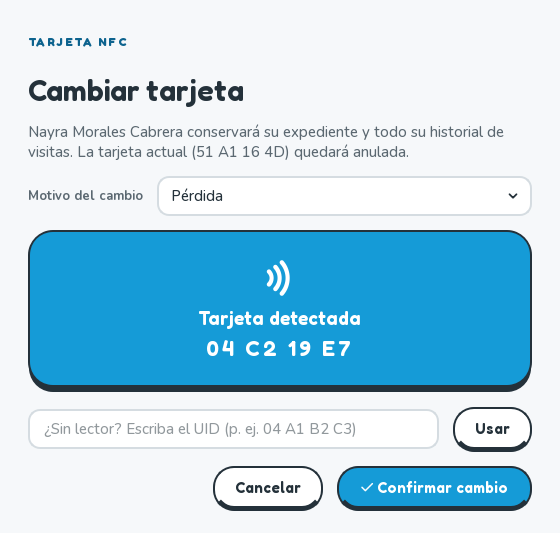
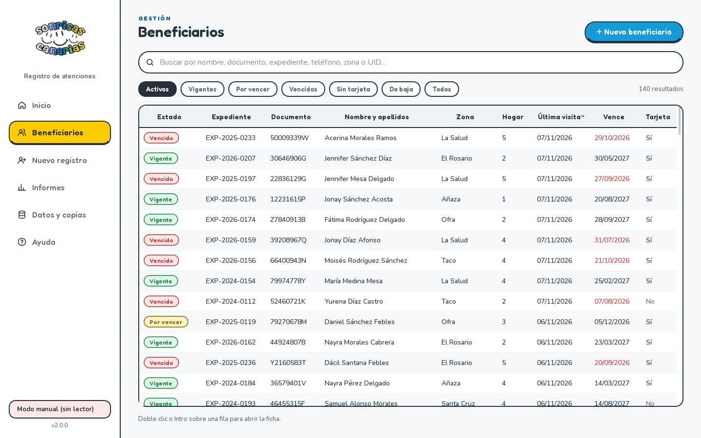
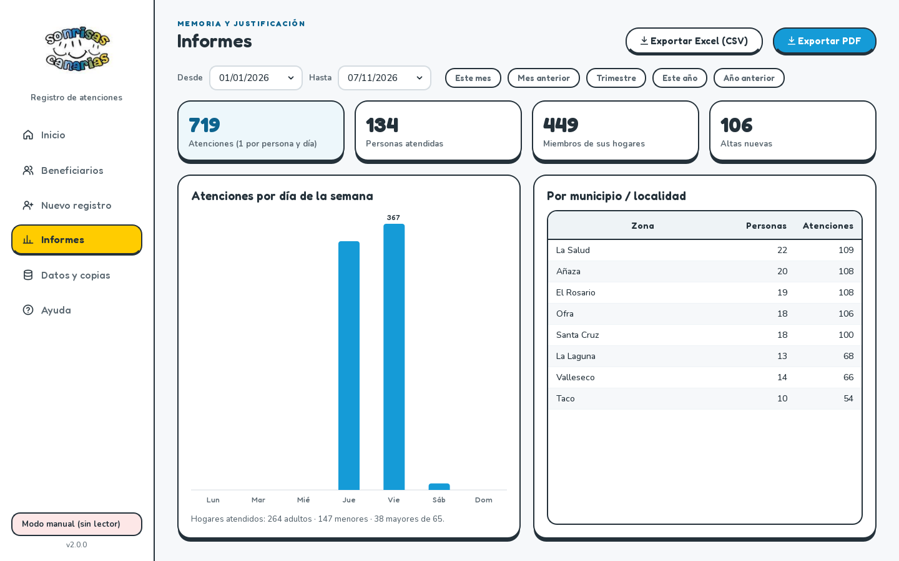
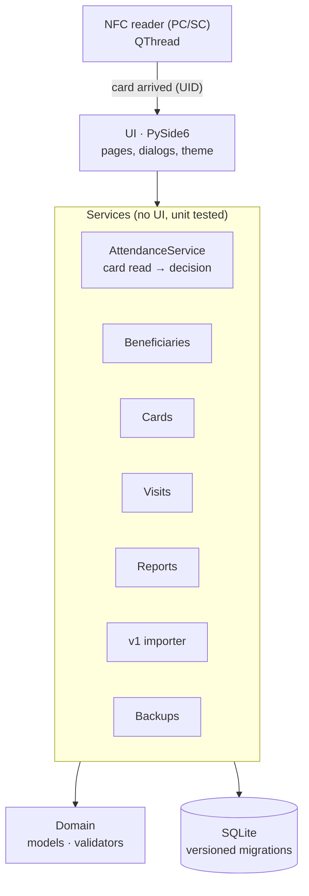

# Sonrisas NFC

**NFC-based beneficiary and attendance management for a food bank run by a non-profit in the Canary Islands.**

A Windows desktop application I built for the food bank of ONG Sonrisas Canarias. It identifies each person with an NFC card and records their attendance. Version 1 has been in use since September 2025; this repository is version 2, a complete rewrite.


-41CD52?logo=qt&logoColor=white)


> The interface is in Spanish. Every screenshot uses fictional data produced by the built-in demo generator (`sonrisas_nfc.demo`). No real database is included in this repository. [Versión en español](README.es.md).

<p>
  
</p>

## Context

The organisation serves families at its food bank. Each person has a social-services file with an expiry date and an NFC card. When the card is read, the person has to be identified, the file checked for validity and the attendance recorded. Those records feed the reports the organisation submits to public bodies and sponsors.

## Version 1

The first version was built with **Python, PyQt5 and SQLite** and has been in use since September 2025, with **487 beneficiaries and 2,447 visits** recorded.

## Version 2: a rewrite driven by an audit

After a year in production I audited the code and the real data, using a script that reports aggregates only and never shows personal records. The audit found problems that mattered for the organisation's reporting:

| Problem in v1 | Impact | Fix in v2 |
|---|---|---|
| A card resting on the reader logged a new visit every 1.5 s | **27 %** of the logged visits were duplicates, which inflated the official reports | One attendance per person per day; the reader fires once when a card *arrives*, not while it stays there |
| A lost card couldn't be replaced without losing the history | Staff created duplicate records | **Card replacement** with a reason (lost, stolen, damaged); the old card is deactivated and flagged if it shows up again |
| No warning for expired files | **279** files had expired unnoticed | Red warning when the card is read; renew for 6 or 12 months in one click |
| The national ID was the primary key | Correcting a typo either did nothing or overwrote someone else's record | Surrogate `id` key; documents can be corrected safely |
| Deleting a person deleted their visits | Past reports changed retroactively | Soft delete: history is kept and the record can be reactivated |
| Loose DNI/NIE regex | Invalid IDs got in | Check-letter validation that suggests the correct letter |
| NFC polling ran on the UI thread | Unplugging the reader meant restarting the app | Dedicated reader thread with hot-plug detection |
| Data stored next to the `.exe` | Reinstalling could wipe it | Data in `%LOCALAPPDATA%`, automatic daily backups, change log |
| One 1,733-line file, ~650 duplicated lines, no tests | Every change was risky | Layered architecture, **115 tests** including end-to-end UI tests, clean lint |

v2 moved to **PySide6 (Qt 6)** and imports the v1 database on first launch without modifying it. Repeated visits on the same day are kept but flagged, so they no longer count in reports.

<table>
  <tr>
    <td width="50%"><br><sub>Card read on an expired file: the visit isn't logged until staff renew the file or confirm.</sub></td>
    <td width="50%"><br><sub>Replacing a lost card keeps the person's full history.</sub></td>
  </tr>
  <tr>
    <td width="50%"><br><sub>Search by name, document or file number, with file status filters.</sub></td>
    <td width="50%"><br><sub>Reports by period, exportable to PDF for funders.</sub></td>
  </tr>
</table>

## Architecture



```
src/sonrisas_nfc/
├── domain/        Entities and validation (no dependencies)
├── db/            SQLite access, transactions, versioned migrations (PRAGMA user_version)
├── services/      Business logic, independent of the UI and covered by tests
├── nfc/           PC/SC reader in its own QThread (card arrival and removal)
└── ui/            PySide6: theme, components, pages, dialogs, PDF reports
```

### Key decisions

- **Visits belong to the person, not the card.** Replacing a card or correcting a document never touches the attendance history. Cards keep their own history (`asignada_en`, `baja_en`, `motivo_baja`), and a **partial unique index** guarantees that a UID is active for one person only. See [`db/database.py`](src/sonrisas_nfc/db/database.py).
- **The card-read decision is a pure service.** [`AttendanceService.procesar_tarjeta`](src/sonrisas_nfc/services/atencion.py) returns an explicit result: visit logged, already attended today, expired file, unknown card, deactivated card or inactive person. The UI only renders it, so every case is tested without a reader attached.
- **Edge detection, not polling results.** [`LectorNFC`](src/sonrisas_nfc/nfc/lector.py) emits a signal only when a card arrives, needs two empty reads before treating it as removed (one failed read doesn't count), closes every connection after reading the UID and recovers when the reader is unplugged and plugged back in.
- **Works without hardware.** Without a reader or PC/SC support the app falls back to manual mode: search, then *Attend now*.
- **Offline and local by design.** Data stays on the organisation's computer with no network access. Daily backups and an audit log cover new records, edits, card changes and deactivations.

## Testing and quality

- **115 automated tests** (pytest): validators, services, the v1 importer, report ordering, and end-to-end UI flows run against an offscreen Qt platform.
- **Ruff** lint with `E, F, I, UP, B, SIM, RUF` rules, all passing.
- A build script runs the tests before packaging with PyInstaller and Inno Setup.

## Getting started

**Requirements:** Windows, Python 3.11+. An NFC reader (PC/SC, e.g. ACR122U) is optional: without one the app runs in manual mode.

```powershell
python -m venv .venv
.venv\Scripts\pip install -e ".[dev]"

.venv\Scripts\sonrisas-nfc --demo     # fictional data in a temporary folder
.venv\Scripts\pytest                  # tests
.venv\Scripts\ruff check src tests    # lint
```

Build the executable and installer (runs the tests first; Inno Setup 6 is optional):

```powershell
powershell -ExecutionPolicy Bypass -File packaging\construir.ps1
```

Migrating from v1 is covered in [`docs/MIGRACION.md`](docs/MIGRACION.md) (Spanish).

## Data protection

- No real data in screenshots, tests or fixtures; `sonrisas_nfc.demo` generates fictional people.
- The repository ignores every `.db`, backup, CSV and exported report.
- The import check script reports counts only, never records.

## My role

Sole developer: data model, implementation, NFC integration, testing, packaging and migration from version 1.

## License

All rights reserved. The code is published for portfolio and review purposes; reuse or deployment by other organisations requires the author's written permission. Fonts Fredoka and Nunito are distributed under the SIL Open Font License.
